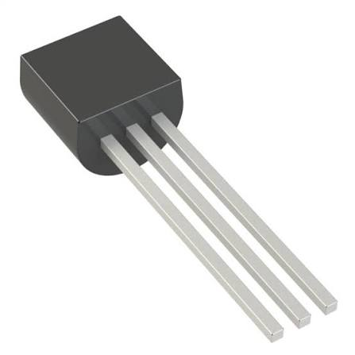
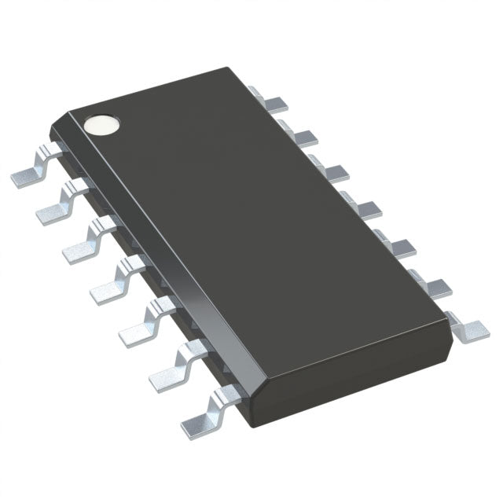

**Temperature Sensor**

1. Microchip Technologies MCP9700A-E/TO

    
    

    * $0.61/each
    * [Link to product](https://www.digikey.com/en/products/detail/microchip-technology/MCP9700A-E-TO/1212508?s=N4IgTCBcDaILIGEAKBOA7ABgwQQLQFEB6AFQHkQBdAXyA)

    | Pros                                      | Cons                                                             |
    | ----------------------------------------- | ---------------------------------------------------------------- |
    | Cost effective                               | Requires ADC conversion |
    | Easy through-hole soldering                      | Analog signal susceptible to noise                                        |
    | Direct PIC ADC connection |

    

2. Texas Instruments TMP36GT9Z

    

    * $1.85/each
    * [Link to product](https://www.digikey.com/en/products/detail/analog-devices-inc/TMP36GT9Z/820404)

    | Pros                                                              | Cons                |
    | ----------------------------------------------------------------- | ------------------- |
    | Wide temperature range                                             | Higher cost      |
    | Simple analog interface                                 | Lower specified accuracy at 25°C |
    | Compatible with 5V supply |

    

3. Texas Instruments TMP235A2DBZR

    
    
    * $0.56/each
    * [Link to product](https://www.digikey.com/en/products/detail/texas-instruments/TMP235A2DBZR/9649793?s=N4IgTCBcDaICoFkAKYDMBWAgmAIgIQC0AlEAXQF8g)

    | Pros                                                              | Cons                |
    | ----------------------------------------------------------------- | ------------------- |
    | Cost effective                                             | Difficult for surface-mount soldering      |
    | Small PCB footprint                                 | Different voltage-to-temperature conversion |
    | Good specified accuracy (±1.2°C (±2°C)) |

    

**Choice:** Option 1: MCP9700A-E/TO

**Rationale:** The MCP9700A is not only cost effective, but provides simple and direct integration for the Curiosity Nano that will be used for this part of the product. Although its readings aren't as accurate at the TMP235A2DBZR, readings are still within a ±2°C range, and will have a more reliable method of installation.

**Operational Amplifier**

1. Microchip Technologies MCP6004-I/SL

    
    

    * $0.53/each
    * [Link to product](https://www.digikey.com/en/products/detail/microchip-technology/MCP6004T-I-SL/523092)

    | Pros                                      | Cons                                                             |
    | ----------------------------------------- | ---------------------------------------------------------------- |
    | Low power consumption supports an efficient subsystem                               | Lower slew rate than the alternatives. |
    | SOIC-14 package is manageable for PCB assembly                      | Four amplifiers may be unnecessary if only one temperature signal needs conditioning.                                        |
    | Operates directly from the subsystem's 5 V supply |

    

2. Texas Instruments TLV9004IDR

   

    * $0.91/each
    * [Link to product](https://www.digikey.com/en/products/detail/texas-instruments/TLV9004IDR/9674911)

    | Pros                                                              | Cons                |
    | ----------------------------------------------------------------- | ------------------- |
    | Lower typical supply current than MCP6004                                             | Four channels may be unnecessary for the current circuit.      |
    | Includes EMI/RFI filtering features                                 | Maximum supply voltage is limited to 5.5 V. |
    | Lower maximum input offset voltage improves potential measurement accuracy |

    

3. Texas Instruments TLV9054IDR

    
    
    * $1.14/each
    * [Link to product](https://www.digikey.com/en/products/detail/texas-instruments/TLV9054IDR/10273198)

    | Pros                                                              | Cons                |
    | ----------------------------------------------------------------- | ------------------- |
    | 5 MHz bandwidth provides room for future applications                                             | Higher power consumption than very low-power alternatives      |
    | Low input offset voltage supports accurate sensing                                 | Higher bandwidth is unnecessary for slow temperature measurements |
    | Available in SOIC-14 for PCB integration |

    

**Choice:** Option 1: MCP6004-I/SL

**Rationale:** The MCP6004 was selected as the best operational amplifier for the subsystem for its effective balance between low power consumption, cost-effectiveness, and compatibility with the subsystem's design. Its operating voltage range of 1.8–6 V allows it to function reliably with the team's regulated 5 V power supply. Additionally, its rail-to-rail input and output capabilities make it suitable for amplifying the MCP9700A temperature sensor's analog voltage through a non-inverting amplifier configuration before sending the signal to the PIC18F57Q43 Curiosity Nano's ADC. In comparison, the TLV9054IDR and TLV9004IDR lack the advantages that the MCP6004 holds.

**Voltage Regulator**

1. Texas Instruments LM7805CT/NOPB

   

   * $1.86/each
   * [Link to product](https://www.digikey.com/en/products/detail/texas-instruments/LM7805CT-NOPB/3901929)

   | Pros | Cons |
   | --- | --- |
   | Provides a stable regulated 5V output | Higher cost than competing regulators |
   | Easy through-hole soldering with TO-220 package | Excess voltage is dissipated as heat |
   | Built-in thermal and overcurrent protection | May require additional cooling at higher loads |

   

2. STMicroelectronics L7805CV

   

   * $1.08/each
   * [Link to product](https://www.digikey.com/en/products/detail/stmicroelectronics/L7805CV/585964)

   | Pros | Cons |
   | --- | --- |
   | Lower cost than LM7805 | Higher typical quiescent current |
   | Regulated 5V output with rated 1.5A capacity | Excess voltage is dissipated as heat |
   | Easy through-hole soldering | May require a heatsink at higher loads |

   

3. Onsemi MC7805CTG

   

   * $0.99/each
   * [Link to product](https://www.digikey.com/en/products/detail/onsemi/MC7805CTG/919333)

   | Pros | Cons |
   | --- | --- |
   | Most cost-effective option | Rated output current is limited to 1A |
   | Built-in thermal and short-circuit protection | Requires adequate thermal management |
   | TO-220 package is convenient for PCB assembly | No significant efficiency advantage over LM7805 |

   

**Choice:** Option 1: LM7805CT/NOPB

**Rationale:** The LM7805 was selected for its reliable 5V voltage regulation, compatibility with the subsystem's 9V DC input, and straightforward through-hole installation. Its built-in thermal and overcurrent protection supports dependable operation, while its output current capability is suitable for the subsystem's preliminary power requirements. Although the alternatives offer lower costs, the LM7805 provides a suitable balance of performance, protection, and ease of integration.

---

**9V DC Power Supply**

1. GlobTek WR9HD1000CCP-F(R6B)

   

   * $10.35/each
   * [Link to product](https://www.digikey.com/en/products/detail/globtek-inc/WR9HD1000LCP-F-R6B/8598260?s=N4IgTCBcDaIO4CcCcALAJgRgAw4DYGMAHAWgDMEA2AIxAF0BfIA)

   | Pros | Cons |
   | --- | --- |
   | Provides regulated 9V DC with 1A maximum output | Requires access to an AC wall outlet |
   | Universal 90–264V AC input | Barrel connector must match PCB power jack |
   | Standard center-positive barrel connector | Limits portability without an independent battery |

   

2. Pololu 1470

   

   * $11.41/each
   * [Link to product](https://www.digikey.com/en/products/detail/pololu/1470/19200211)

   | Pros | Cons |
   | --- | --- |
   | Provides stable 9V DC with 1A maximum output | Higher cost than GlobTek |
   | Universal 100–240V AC input | Requires an external AC outlet |
   | Standard center-positive barrel connector | Additional marketplace shipping costs may apply |

   

3. Jameco ReliaPro DDU090100J0490

   

   * $12.89/each
   * [Link to product](https://www.digikey.com/en/products/detail/jameco-electronics/DDU090100J0490/25965882)

   | Pros | Cons |
   | --- | --- |
   | Provides 9V DC with 1A maximum output | Highest cost of the three options |
   | Center-positive barrel connector simplifies integration | Limited to 120V AC input |
   | Suitable for powering the LM7805 regulator | Additional marketplace shipping costs may apply |

   

**Choice:** Option 1: GlobTek WR9HD1000CCP-F(R6B)

**Rationale:** The GlobTek power adapter was selected for its cost-effectiveness, regulated 9V DC output, and compatibility with the LM7805 voltage regulator. Its 1A maximum output current is sufficient for the subsystem's preliminary power requirements, while its universal AC input and standard barrel connector simplify integration. Compared to the alternatives, the GlobTek provides a practical balance of cost, reliability, and electrical compatibility for RadioLink.

