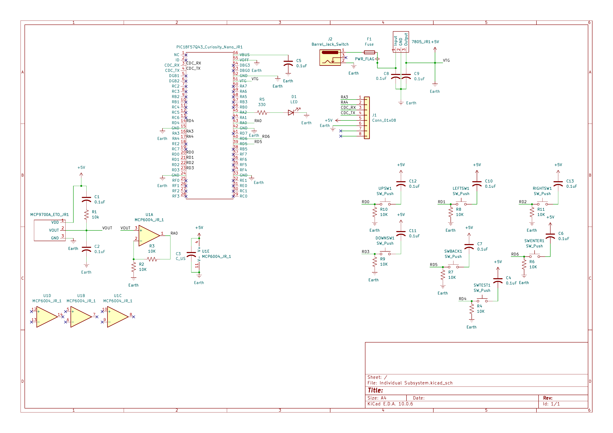

## Overview

This schematic is designed to support an individual subsystem that reads surrounding temperature, and communicates with other team members' boards. This system uses an MCP9700-E/TO to measure the temperature, while an MCP6004 operational amplifier conditions & amplifies the analog signal before the PIC18F57Q43 Curiosity Nano microcontroller processes it. Additionally, this subsystem includes 4 directional buttons (FWD, BACK, LEFT, RIGHT), and 2 action buttons (ENTER, BACK), for user input, while a test button and LED may be used for debugging and verification. Power is supplied through a regulated 5V system, as capacitors are used to stabilize power and for signal filtering. UART communication is also used through RA3 and RA4 to transmit and receive information between the other subsystems of the project. 

{style width:"350" height:"300;"}
**Figure 1:** Subsystem schematic for function buttons and temperature sensor.

## Resouces

The schematic as a PDF download is available [*here*](Individual Subsystem.pdf), and the Zip folder of the project [*here*](Individual Subsystem.zip).
