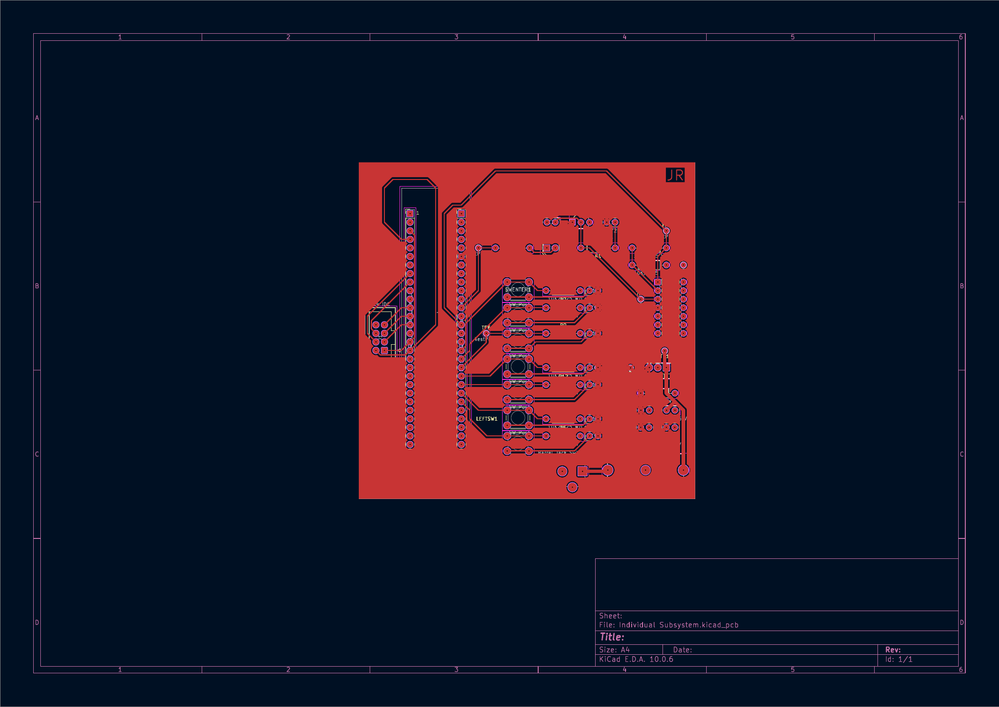
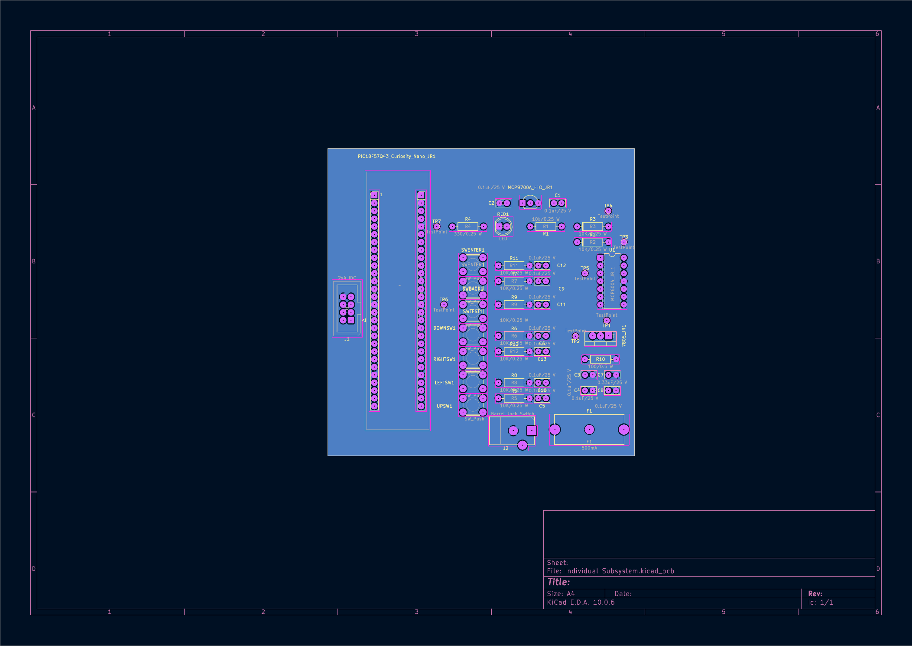

---
title: PCB Design
---

# PCB Design

## Introduction

This page documents the printed circuit board (PCB) design developed for my individual subsystem of the RadioLink project for EGR 304, Team 105. The PCB was designed using KiCad 10 and incorporates the necessary circuitry for temperature monitoring, user input, power regulation, and communication with the other subsystems.

The design includes a PIC18F57Q43 Curiosity Nano microcontroller, MCP9700A temperature sensor, MCP6004 operational amplifier, LM7805 voltage regulator, pushbuttons, and a ribbon cable connector. The PCB layout was developed with consideration for component placement, routing, electrical connectivity, and manufacturing requirements.

## Front PCB Layout

The front side of the PCB contains the component placement and copper routing for the individual subsystem.

[Download Front PCB Layout (PDF)](Front_PCB.pdf)

## Back PCB Layout

The back side of the PCB contains the bottom copper layer and additional routing required to complete the electrical connections.

[Download Back PCB Layout (PDF)](Back_PCB.pdf)

## Design Considerations

The PCB was designed with the following considerations:

1. **Component Placement:** Components were arranged to provide adequate spacing, simplify routing, and support assembly.

2. **Power Distribution:** The LM7805 regulates the 9 V DC input to provide a 5 V supply for the subsystem.

3. **Signal Routing:** The temperature sensor output is processed through the MCP6004 amplifier before being measured by the microcontroller's ADC.

4. **Communication:** A 2x4 IDC connector provides the required interconnection with the other RadioLink subsystems.

5. **Manufacturability:** The PCB layout was developed according to the applicable design rules, board size constraints, and manufacturing specifications.

## KiCad Project Files

The complete KiCad project, including the schematic, PCB layout, and supporting custom libraries, is provided below.

[Download Complete KiCad Project (ZIP)](RadioLink_PCB_Project.zip)

## Gerber Manufacturing Files

The Gerber archive includes the exported manufacturing layers and associated drill files used for design-for-manufacturability verification.

[Download Gerber and Drill Files (ZIP)](RadioLink_Gerber_Files.zip)

## Design Verification

The PCB design is verified using KiCad's Design Rules Checker (DRC) to identify electrical and physical layout issues.

The exported Gerber files are also evaluated using JLCDFM to identify potential manufacturing issues before the design is submitted for fabrication.

## Conclusion

The PCB design represents the physical implementation of my RadioLink individual subsystem. The layout integrates the microcontroller, temperature sensing circuit, power regulation, user inputs, and inter-board connections into a single board. Design verification and manufacturability analysis help ensure that the PCB can be assembled, tested, and incorporated into the completed RadioLink system.
